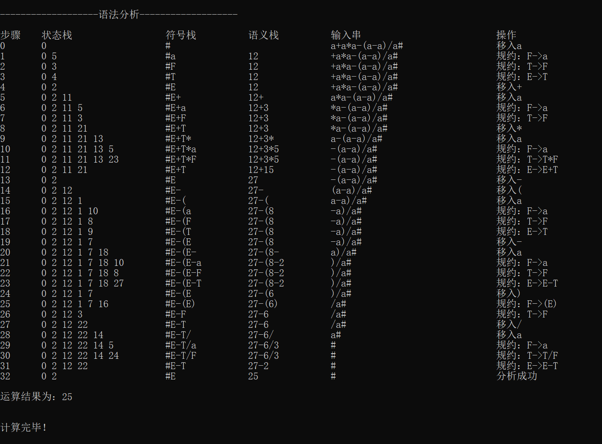

# 简单计算器

*Last Updated 11.28 by Nie Zili*

## 介绍
基于编译原理实现的一个简单的计算器系统，包含了词法分析、语法分析、语义分析三部分

## 项目结构

解决方案sln包含在Calculator子目录下，这也是我们的主函数入口所在。目前解决方案中包含三个项目，分别是LexcialAnalysis词法分析、LR1语法分析与Calculator计算器主项目。

为了使Calculator中可以正常调用其他项目的头文件，需要在Calculator项目的“附加包含目录”中添加其余项目的根目录，并且将其余项目的“配置类型”，修改为“静态库lib”

以上设置我已经做完，如果不能运行首先检查配置是否有问题。

## 计算器文法

文法如下（新增了幂运算）：

```c
E-E+T
E-E-T
E-T
T-T*F
T-T/F
T-F
F-F^G
F-G
G-(E)
G-a
```

此为无二义性的标准LR系文法，该项目使用的LR1语法分析没有处理二义性问题。上述计算器文法满足加、减、乘、除、括号运算。

## 一、词法分析

这里的词法分析说的是将用户输入的字符串，拆分成符合我们文法的形式，比如说用户输入`12.5+3.2*5.1`，那么词法分析应该将其中的数字与运算符拆分，并最终以`a+a*a`的形式提交给语法分析程序。

我们定义了以下结构体来表示词法分析的结果：

```c++
struct symbol
{
    string ch = "a";            // 默认字符a
    double val = 0.0;           // 支持浮点数运算
    bool operand = false;       // 是操作数则为true，是运算符则为false
}
```

因此在执行完`parsing()`函数后，会获得一个`vector<symbol>`作为词法分析的结果。

## 二、语法分析LR1

见项目[LR1语法分析](https://gitee.com/Morphlng/lr1-grammar-analysis)

## 三、语义分析

我们将语义分析整合在了语法分析的预测函数中，设置三个栈：符号栈、状态栈与语义栈，分析过程的伪代码描述如下：

```c++
bool predict(vector<symbol> parse_result)
{
    SYMBOL;       // 符号栈
    STATE;        // 状态栈
    SEMANTIC;     // 语义栈

    SYMBOL.push("#");   // 初始状态
    STATE.push(0);

    int i=0;
    while(true)
    {
        topsym;       // 取符号栈头
        topstate;     // 取状态栈头
        readahead;    // 取读头

        if(符号栈头为非终结符)      // GOTO
        {
            STATE.push(table[topstate][topsym]);
            state = STATE.top();
        }

        action = table[topstate][current];      // ACTION
        if(action == "acc")
        {
            语义栈头即为运算结果;
            return true;
        }

        if(action == "")        // 没有相应动作说明无法匹配
        {
            return false;
        }

        if(action == "移入m")
        {
            STATE.push(m);
            SYMBOL.push(readahead);
            SEMANTIC.push(readahead.val);
        }
        else if(action == "规约n")
        {
            if(产生式n右部与符号栈不匹配)
            {
                return false;
            }
            else
            {
                SYMBOL、STATE、SEMANTIC栈弹出对应项。
            }

            switch(n)
            {
                按照对应产生式的语义进行计算。
            }
            SYMBOL.push(reduce_result)
            SEMANTIC.push(reduce_result.val);
        }
    }

    return false;
}
```

## 说明

语法分析会输出计算过程，但是由于输入串长度无法预知，因此不能保证输出对齐。实例运行结果如下图：



